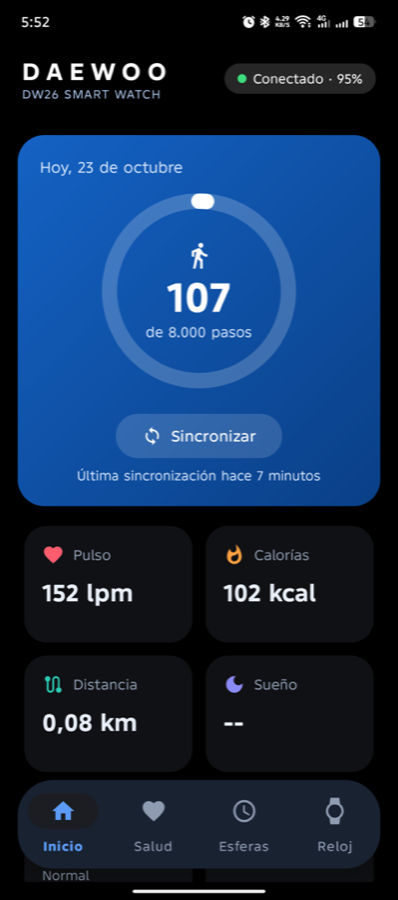
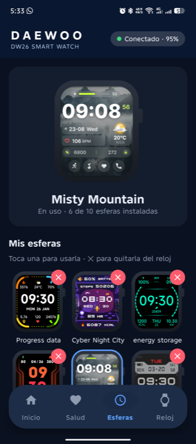
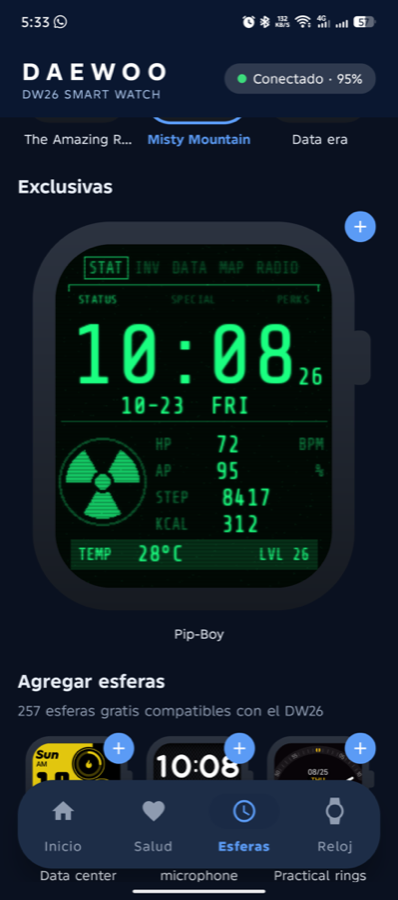

<h1 align="center">
  <br>
  Pulsix · Smartwatch companion app for Android
</h1>

<p align="center">
  
  
  
  <a href="LICENSE"></a>
</p>

<p align="center">
  <a href="https://metalsyntax.github.io/Pulsix-Multiwatch/">Website</a> •
  <a href="#-status">Status</a> •
  <a href="#-supported-devices">Devices</a> •
  <a href="#-install">How to install</a> •
  <a href="#-watch-faces">Watch faces</a> •
  <a href="#known-issues">Known Issues</a> •
  <a href="#build-instructions-for-developers">How to compile</a> •
  <a href="#credits--acknowledgments">Credits</a>
</p>

**Pulsix** (*pulso* + x, like its sibling [Mandix](https://github.com/MetalSyntax/Mandix-Multicontrol)) is a clean, ad-free replacement for the stock companion app of the **Daewoo DW26** smartwatch. It pairs with the watch over Bluetooth LE and handles health data, notifications, calls, music, weather, alarms and watch faces — including faces designed from scratch, like a green-phosphor **Pip-Boy** terminal. No account and no tracking: the only network calls are the weather forecast and the optional watch-face catalog.

The DW26 runs on the **IDO** platform (the same one behind the *VeryFit* app), so the app talks to it through IDO's SDK, which each user extracts from their own VeryFit install. Support for more watches is planned.

<p align="center">
  
  
  
</p>

---

## ✨ Status

**Current version: v0.5** — used daily on the developer's own DW26.

- [x] **Pairing & auto-reconnect**, kept alive by a foreground service.
- [x] **Daily health**: steps vs. goal ring, heart rate, calories, distance, sleep stages and score, stress and SpO₂, with 7-day charts.
- [x] **Notifications** from any app (WhatsApp, Telegram, SMS…), with an on/off switch. *(not yet confirmed on the watch)*
- [x] **Calls**: incoming caller name on the watch and **missed-call** alerts. *(not yet confirmed on the watch)*
- [x] **Music**: song title, artist and play state on the watch; play/pause/next/volume from the wrist.
- [x] **Weather** on the watch: current, 6-day and 24-hour forecast from [Open-Meteo](https://open-meteo.com) (no API key).
- [x] **Alarms**: up to 10, with repeat days, synced both ways.
- [x] **Watch faces**: installed faces shown inside a simulated DW26, switch or remove them, install from the free catalog (250+) or from the app's own faces.
- [x] **Find my watch** (vibrates for 15 s) and **find my phone** from the watch *(find my phone not yet confirmed)*.
- [x] **Daily step goal** presets, synced to the watch.
- [x] **Themes**: automatic, light, dark and pure **black** (AMOLED).
- [ ] More health settings, reminders, contacts, workouts… see [`ROADMAP.md`](ROADMAP.md).

---

## ⌚ Supported Devices

| Watch | Platform | Status |
| :--- | :---: | :--- |
| **Daewoo DW26** (firmware 1.01.00) | IDO, V3 protocol | ✅ Tested daily |
| Other watches that use the **VeryFit** app | IDO | ❔ Likely partial support, untested |

> [!NOTE]
> Only one app can be bound to the watch at a time. Pairing with Pulsix unbinds VeryFit, and vice versa — sync in VeryFit first so no data is lost.

---

## 📲 Install

There is no downloadable APK: the app needs IDO's SDK and native library, which can't be redistributed. You build it once with the files from **your own** VeryFit install:

1. Install **VeryFit 3.4.0** (`com.sport.fitplus1`) on an arm64 Android phone and connect the phone by `adb` — or keep its APKs at hand.
2. Run the extractor (details in [Build Instructions](#build-instructions-for-developers)) and build the APK.
3. Install it, open the app, tap **Buscar reloj** with the watch's screen on, pick the DW26 and accept the pairing on the watch.
4. In **Reloj → Funciones**, turn on notifications, music, calls and weather and grant the permissions Android asks for.

> [!TIP]
> If VeryFit keeps reconnecting in the background and stealing the watch, disable it temporarily: `adb shell pm disable-user com.sport.fitplus1` (undo with `pm enable`).

---

## 🎨 Watch faces

The **Faces** tab shows the faces installed on the watch inside a simulated DW26 (240×284 screen), the app's own faces and the free catalog.

Custom faces are built with Python scripts in [`tools/faces/`](tools/faces/). The **Pip-Boy** face (green CRT terminal with time, date, heart rate, battery, steps, calories and temperature) is generated with:

```bash
python3 -I tools/faces/pipboy/build.py
# → app/src/main/assets/faces/pipboy.zip
```

The face format is a zip with an `iwf.json` layout (positioned widgets: time, seconds, date, weekday, heart rate, battery, steps, calories, weather…) plus one PNG per glyph.

---

## Known Issues

- **Very little face storage**: the DW26 keeps faces uncompressed (~300 KB each) and has ~140 KB free with the stock set, so adding a face usually means removing another. The app asks which one to replace.
- **Find my watch**: the DW26 doesn't implement IDO's "find device" command, so the app sends a fake incoming call (*"Buscando tu reloj"*) to make it vibrate.
- **Paid catalog faces** aren't shown (they need a VeryFit account).
- UI text is currently **Spanish only**.
- Only **arm64** phones: the extracted native library is the arm64 build.

---

## Build Instructions (For Developers)

### Prerequisites

- JDK 17
- Android SDK (compile SDK 34) — Android Studio or the command-line tools.
- [dex2jar](https://github.com/pxb1988/dex2jar) (`brew install dex2jar`), `unzip` and, for phone mode, `adb`.

### Compilation Commands

```bash
git clone https://github.com/MetalSyntax/Pulsix-Multiwatch.git
cd Pulsix-Multiwatch

# extract IDO's SDK, native libs and catalog key from YOUR VeryFit install
tools/extract_sdk.sh                                           # phone connected by adb
tools/extract_sdk.sh base.apk split_config.arm64_v8a.apk        # or from the APK files

./gradlew assembleDebug
# APK → app/build/outputs/apk/debug/app-debug.apk
```

The extractor writes `app/libs/*.jar`, `app/src/main/jniLibs/arm64-v8a/*.so` and `ido.properties`, all git-ignored.

### Testing without touching the phone

```bash
tools/cmd.sh sync | live | info | find | time | connect
tools/cmd.sh theme black        # auto | light | dark | black
tools/cmd.sh face pipboy        # install a bundled face
tools/tap.sh X Y                # tap only if the app is in the foreground
```

### Project layout

```text
app/src/main/java/com/metalsyntax/dw26/
  App.kt           SDK init; proxies every IDO callback into one event stream
  Watch.kt         watch state and automatic reactions (sync, find phone, media keys)
  WatchService.kt  foreground service that keeps the BLE link alive
  Health.kt        daily health summary (the SDK doesn't store V3 data)
  Faces.kt         installed faces, free catalog, install/replace
  Alarms.kt  Weather.kt  Music.kt  Calls.kt  NotifListener.kt
  MainActivity.kt  Home / Health / Faces / Watch tabs
  Charts.kt        ring, bar/line charts and the simulated watch (WatchMock)
tools/extract_sdk.sh   pulls IDO's SDK out of VeryFit
tools/faces/           custom watch-face generators
```

---

## Credits & Acknowledgments

- **IDO / idoosmart** — watch platform and SDK (not included; extracted from each user's VeryFit install).
- **[Open-Meteo](https://open-meteo.com)** — free weather forecast API.
- **[Share Tech Mono](https://fonts.google.com/specimen/Share+Tech+Mono)** by Carrois Type Design (SIL OFL 1.1) — Pip-Boy face digits.
- Pip-Boy face is a fan tribute to the *Fallout* series.
- Developed by [MetalSyntax](https://github.com/MetalSyntax).

## License

Released under the [MIT License](LICENSE). The font in `tools/faces/` keeps its own license (OFL). IDO's SDK and native libraries extracted by `tools/extract_sdk.sh` are **not** covered by this license and must not be redistributed.

**Unofficial project.** Not affiliated with, endorsed or sponsored by Daewoo, IDO (idoosmart) or Bethesda. "Daewoo", "VeryFit" and "Pip-Boy" are trademarks of their respective owners and are used only to identify the compatible watch and the style of the face.
